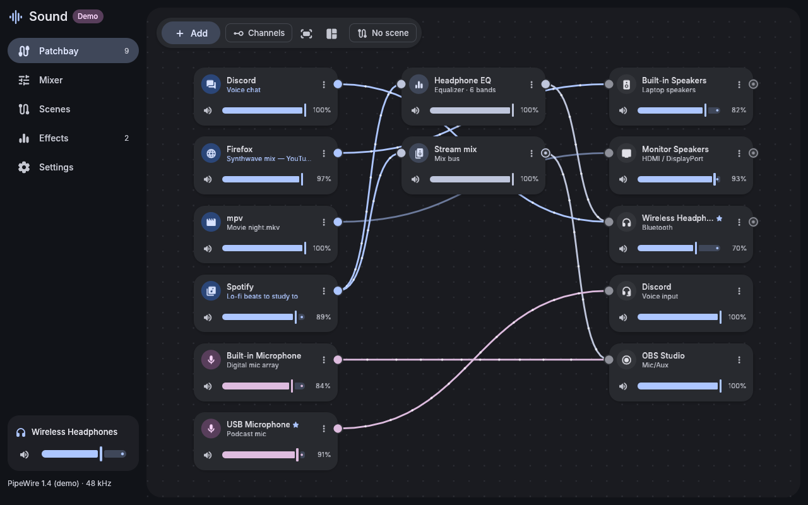
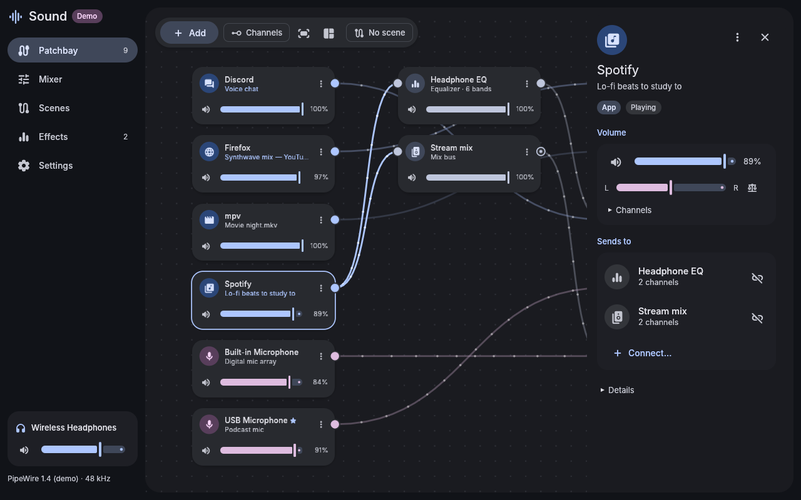
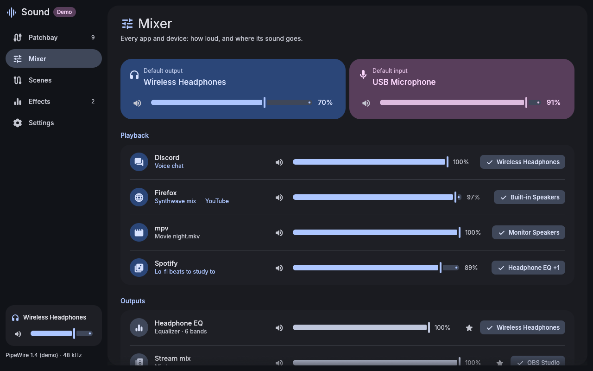
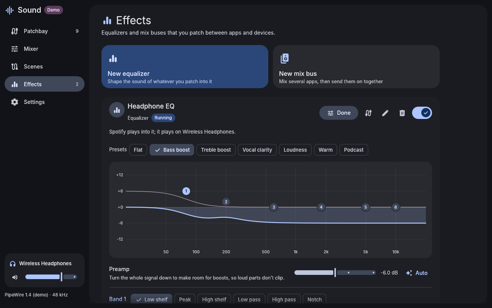
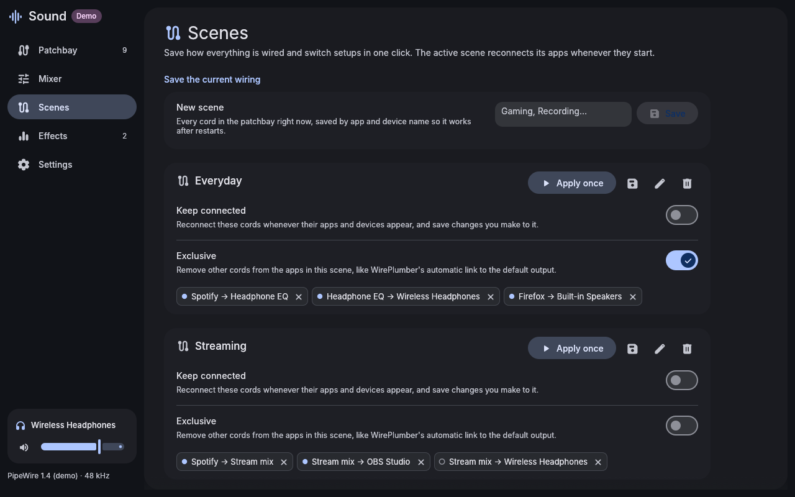

# Material 3 Sound

A patchbay and mixer for PipeWire, built with [egui](https://github.com/emilk/egui) and themed with Material You. Draw cords from the apps that play sound to your speakers, headphones, equalizers and recorders, and they're wired that way. Every app and device gets its own volume, balance and mute, and you can save whole wirings as scenes. It shares its look, widgets and fonts with the other Material 3 apps through [material-3-ui](https://github.com/bhimio1/material-3-ui), and on an end-4 desktop it takes its colors from your wallpaper.



| Inspector | Mixer |
| --- | --- |
|  |  |
| **Equalizer** | **Scenes** |
|  |  |

## Features

**Patchbay**
- Every app playing or recording sound, every output and input device, and every effect is a card. Sources sit on the left, effects in the middle, and destinations on the right. Drag cards anywhere, and they stay where you put them.
- **Draw a cord** from a card's jack to another card to send sound there. Channels pair up by name (left to left, right to right). Mono fans out to both sides, and stereo folds into a mono input.
- One app can play on several devices at once: draw more cords. Click a cord and press Delete (or its unplug button) to disconnect it.
- **Channels** shows a pin per channel, for routing left and right separately or sending one channel somewhere else.
- Cords carry their source's color, and dots flow along the ones carrying sound. A device's monitor jack (what it's playing) can be patched onward too, for example into OBS.
- Each card has a volume slider and mute. The **inspector** (click a card) adds balance, per-channel levels, the default device switch, and every connection in and out.
- Right-click a card or the canvas for more: mute, use as default, disconnect everything, hide, new effects, fit, arrange.

**Mixer**
- The default output and input, big, at the top.
- A row for every app, output, input and recording app, each with volume, mute and the default star. A chip shows where each app's sound goes; its menu adds or removes destinations.

**Effects**
- **Equalizers:** a parametric EQ (low and high shelves, peaks, low and high pass, notch) with a preamp. You shape it on its frequency response: drag a band's handle to move it, scroll on it to change its width, and double-click to add a band. It comes with presets (Bass boost, Vocal clarity, Loudness, …) and an Auto preamp that leaves headroom for the loudest boost. Moving a band takes effect immediately, with no gap in the sound.
- **Mix buses:** a virtual output. Send several apps into it, then send its monitor on to devices or a recorder. Its volume sets the whole mix.
- Effects are PipeWire nodes like any other: patch apps into them and them into devices.

**Scenes**
- Save the current wiring by name ("Gaming", "Recording") and apply it in one click.
- Keep a scene **active**, and its cords come back whenever its apps start, for example when Spotify opens again. Cords you draw or remove while it's active are saved to it.
- An **exclusive** scene also removes other cords from its apps, such as WirePlumber's automatic link to the default output.

**Startup**
- Effects keep running after you close the window. `m3-sound --restore` starts them and reconnects the active scene without opening a window, so it can run at login (for Hyprland: `exec-once = m3-sound --restore`).

Try it without touching your sound: `m3-sound --demo` opens a simulated desktop.

## How it works

Sound talks to PipeWire through its own command-line tools, so nothing needs compiling against PipeWire:

- The graph comes from `pw-dump --monitor`, live.
- Cords are links made and removed with `pw-link`.
- Volumes and mute go through `pw-cli set-param`. For sound cards this sets the device route, so WirePlumber remembers it like it does for pavucontrol.
- The default devices are set with `pw-metadata`.
- An equalizer is a PipeWire filter-chain of biquads, run as its own `pipewire -c` process from a configuration in `~/.local/state/m3-sound/effects/`. Band changes reach it live through `pw-cli`. Changing a band's type restarts it, and its cords are put back.
- A mix bus is a lingering null sink. It lasts until PipeWire restarts, and Sound (or `--restore`) brings it back.

It needs PipeWire with WirePlumber, which most current distributions run by default.

## Keys

| Key | Does |
| --- | --- |
| Ctrl+1 … Ctrl+5 | Patchbay, Mixer, Scenes, Effects, Settings |
| Delete | Disconnect the selected cord |
| Ctrl+0 | Fit the patchbay to the window |
| Escape | Clear the selection, cancel a cord |

## Install

The release workflow publishes `material-3-sound-bin` (prebuilt) and `material-3-sound-git` to the AUR when a version is tagged:

```sh
paru -S material-3-sound-bin   # or material-3-sound-git
```

From this repository, with the included PKGBUILD:

```sh
cd packaging
makepkg -si
```

Or build it yourself (Rust stable):

```sh
cargo build --release
install -Dm755 target/release/m3-sound ~/.local/bin/m3-sound
install -Dm644 packaging/material_3_sound.desktop ~/.local/share/applications/material_3_sound.desktop
```

## Theme

In Settings, **Auto** uses the end-4 shell's generated colors (`~/.local/state/quickshell/user/generated/colors.json`). If those don't exist it uses the file manager's matugen `theme.json`, and otherwise a seed color. The theme updates live when the wallpaper changes.

Settings, card positions, scenes and effects are stored in `~/.config/m3-sound/config.json`. The demo never saves.

## Project layout

```
src/
  app.rs        app state, navigation, actions, keeping scenes and effects in sync
  backend.rs    pw-dump monitor and the command worker (pw-link, pw-cli, pw-metadata, pipewire -c)
  pwdump.rs     pw-dump JSON into the graph
  graph.rs      nodes, ports, links, devices, defaults, and pairing channels
  units.rs      cards and cords: effects merged into one card, links bundled per pair
  scenes.rs     scenes saved by name, and what to change to match one
  effects.rs    equalizers (biquad math, filter-chain configuration) and mix buses
  volume.rs     slider ↔ PipeWire volumes, balance
  demo.rs       the simulated desktop for --demo
  restore.rs    --restore
  ui/           patchbay, inspector, mixer, scenes, effects, settings, shared widgets
packaging/      PKGBUILDs and the desktop entry
```

The palette, egui style, fonts, widgets, page scaffolding, toasts and file saving come from [material-3-ui](https://github.com/bhimio1/material-3-ui), pinned to a commit in `Cargo.toml`.

## Testing

`cargo test` runs the unit tests, including parsing a real `pw-dump` (`tests/fixtures/pw-dump.json`).

The backend also has an integration test against a real PipeWire and WirePlumber. It draws cords, sets volumes and the default device, and starts, adjusts and stops an equalizer and a bus. CI runs it in a private session with null sinks for devices:

```sh
M3S_PIPEWIRE_TEST=1 scripts/pipewire-test-session.sh cargo test -- --ignored
```

The script is meant for CI and containers. On a desktop, its private WirePlumber would also try to open your sound cards.

## License

MIT, see [LICENSE](LICENSE).

Fonts: Inter (SIL OFL 1.1, see `assets/fonts/LICENSE-Inter.txt`). Icons: Material Symbols, via `egui_material_icons` (both bundled through material-3-ui).
